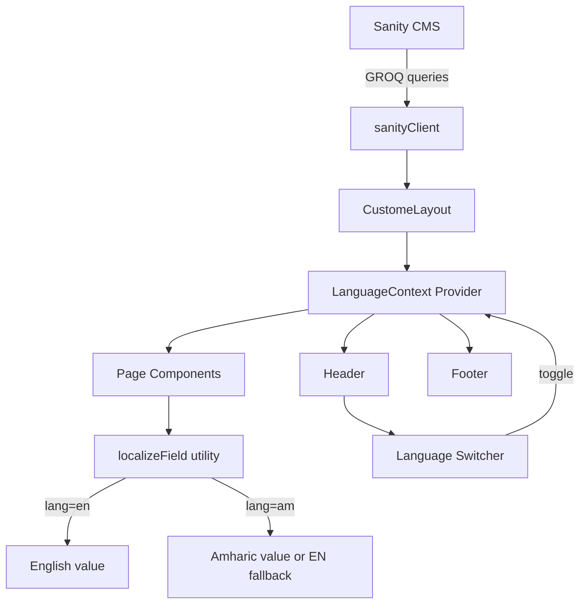

# Design Document

## Overview

This document describes the architecture, components, data models, and implementation strategy for restoring all missing UI sections from the original Metro Real Estate frontend, adding a functional bilingual (EN/AM) language switcher backed by Sanity CMS, and wiring up the footer email subscription form.

The changes span three layers:
1. **Sanity CMS schemas** — new fields for bilingual content, floor plans, map locations, virtual tour URLs, WhatsApp number, secondary images, and news secondary images.
2. **Frontend Next.js components** — restored/new sections on each affected page, a `LanguageContext`, and a `localizeField` utility.
3. **GROQ queries** — updated to fetch the new Amharic fields alongside existing English fields.

---

## Architecture



The `LanguageContext` lives inside `CustomeLayout`, wrapping the entire app. It reads the initial language from `localStorage` and exposes `{ lang, setLang }`. Every page and section that renders CMS text passes it through `localizeField(data, 'fieldName', lang)` to get the right value.

---

## Components and Interfaces

### New: `src/context/LanguageContext.tsx`
```ts
interface LanguageContextProps {
  lang: 'en' | 'am'
  setLang: (lang: 'en' | 'am') => void
}
```
- Reads initial value from `localStorage.getItem('metro_lang')` (defaults to `'en'`).
- Writes to `localStorage` on every change.
- Provided at the root level inside `CustomeLayout.tsx`.

### New: `src/lib/localize.ts`
```ts
// Returns the Amharic value if lang === 'am' and it exists, else the English value.
export function localizeField(
  data: Record<string, any> | null | undefined,
  field: string,
  lang: 'en' | 'am'
): any
```
Convention: Amharic fields in Sanity are named `<fieldName>_am`. For example, `heroHeadlineText` has a sibling field `heroHeadlineText_am`. `localizeField(data, 'heroHeadlineText', lang)` returns `data.heroHeadlineText_am` when `lang === 'am'` and it's non-empty, otherwise `data.heroHeadlineText`.

For Portable Text (block arrays), the convention is `description1` / `description1_am`.

### Modified: `src/app/CustomeLayout.tsx`
- Import and wrap children with `<LanguageProvider>`.
- The `ScrollDownIcon` button already exists in `CustomeLayout` but is `cursor-none` and fixed — it should be moved into the `LandingVideo` component so it scrolls to `nextSectionRef` (Requirement 1). The `CustomeLayout` version should be removed to avoid duplication.

### Modified: `src/sections/Header.tsx`
- Add `News Room` link between Gallery and Properties in the desktop nav.
- Replace the static EN/AM dropdown with a functional switcher that calls `setLang` from `LanguageContext`.

### Modified: `src/sections/Home/LandingVideo.tsx`
- Accept a `nextSectionRef` prop (already present).
- Add a scroll-down icon button at the bottom-center of the hero that calls `nextSectionRef.current?.scrollIntoView({ behavior: 'smooth' })` on click.

### Modified: `src/app/page.tsx`
- Insert `<NumbersSection setRegisterInterestOpen={setRegisterInterestOpen} />` between `<DescriptionSection>` and the dark elegance section.
- Pass CMS stats to `NumbersSection` via props.

### Modified: `src/sections/Home/NumbersSection.tsx`
- Remove `bg-red-300 border-[1px] border-red-500` debug classes.
- Accept `stats`, `heading`, `paragraph1`, `paragraph2` props with fallbacks, following the same CMS-or-fallback pattern as other sections.

### Modified: All life-style pages (`2-1A-bedroom-apartment`, `3-2A-bedroom-apartment`, `4-bedroom-apartments`, `penthouse`, `villas`, `townhouses`)
Each page gets three additions after the existing stats grid:
1. **Floor plan section** — full-width image from `unit.floorPlanImage` or fallback `Plan.jpg`.
2. **Location map** — pigeon-maps embed using `unit.mapLocation` or coords fallback.
3. **Cross-sell section** — the "Discover Metro Properties" 3-card section, extracted into a shared `<DiscoverProperties />` component.
4. **Register Interest CTA button** — placed below amenity cards, above cross-sell.

### New: `src/sections/DiscoverProperties.tsx`
A shared component rendering the "Discover Metro Properties" heading, divider, and 3-card desktop grid + mobile Splide carousel. Currently duplicated across `projects/[slug]/page.tsx` and `news-room/[slug]/page.tsx` — extract to a single reusable component used by all consumers.

### Modified: `src/app/projects/[slug]/page.tsx`
- Add 360 virtual tour section (rendered only when `project.virtualTourUrl` is non-empty).
- Replace inline "Discover Metro Properties" section with `<DiscoverProperties />`.

### Modified: `src/app/about-metro/page.tsx`
- Add `secondaryBannerImage` render between intro text and stats.
- Add `tourSectionImage` section after gallery images, before team section.

### Modified: `src/app/contact/page.tsx`
- Add WhatsApp link using `siteSettings.whatsappNumber` (fetched in `CustomeLayout` and passed down, or fetched locally in contact page) with `whatsupIcon.svg`.

### Modified: `src/app/news-room/page.tsx`
- Extract the first article as a featured hero card (full-width, larger image, bigger title).
- Render remaining articles in the existing 3-column grid.

### Modified: `src/app/news-room/[slug]/page.tsx`
- Render `secondaryImage` (from CMS or `NewsDetail.svg` fallback) as a decorative element alongside `description2`.

### Modified: `src/sections/Footer.tsx`
- Add `useState` for email, loading, success, error.
- Wire form `onSubmit` to EmailJS using the same service/template/key env vars as the contact form.
- Show inline success/error feedback.

---

## Data Models

### Sanity Schema Changes

#### `siteSettings` — new fields
| Field | Type | Description |
|---|---|---|
| `whatsappNumber` | `string` | WhatsApp contact number |

Plus Amharic variants of: `headOfficeAddress_am`, `branchOfficeAddress_am`.

#### `homePage` — new/modified fields
All existing text fields gain an `_am` Amharic sibling. Additionally:
| Field | Type | Description |
|---|---|---|
| `heroHeadlineText_am` | `string` | Amharic hero headline |
| `introTagline_am` | `string` | Amharic tagline |
| `introHeading_am` | `string` | Amharic heading |
| `introParagraph1_am` | `array` of block | Amharic paragraph |
| `introParagraph2_am` | `array` of block | Amharic paragraph |
| `eleganceSectionHeading_am` | `string` | |
| `eleganceParagraph1_am` | `text` | |
| `eleganceParagraph2_am` | `text` | |
| `propertyTypesHeading1_am` | `string` | |
| `propertyTypesHeading2_am` | `string` | |
| `propertyTypesParagraph1_am` | `text` | |
| `propertyTypesParagraph2_am` | `text` | |
| `consultationHeading_am` | `string` | |
| `consultationSubheading_am` | `string` | |
| `consultationBody_am` | `text` | |
| `stats` — `statItem` object | `label_am`, `description_am` sub-fields | |

#### `aboutPage` — new/modified fields
| Field | Type | Description |
|---|---|---|
| `secondaryBannerImage` | `image` | Decorative image after intro text |
| `tourSectionImage` | `image` | Tour/video section image |
| All text fields | `_am` sibling | Amharic variants |

#### `contactPage` — new/modified fields
| Field | Type | Description |
|---|---|---|
| All text fields | `_am` sibling | Amharic variants |

#### `project` — new/modified fields
| Field | Type | Description |
|---|---|---|
| `virtualTourUrl` | `url` | 360/virtual tour link |
| All text fields | `_am` sibling | Amharic variants |

#### `propertyUnit` — new/modified fields
| Field | Type | Description |
|---|---|---|
| `floorPlanImage` | `image` | Floor plan image |
| `mapLocation` | `mapLocation` object | Lat/lng for map embed |
| All text fields | `_am` sibling | Amharic variants |

#### `metroNews` — new/modified fields
| Field | Type | Description |
|---|---|---|
| `secondaryImage` | `image` | Decorative article image |
| All text fields | `_am` sibling | Amharic variants |

#### `galleryPage` — new/modified fields
| Field | Type | Description |
|---|---|---|
| `title_am` | `string` | Amharic gallery title |

#### `statItem` object — new fields
| Field | Type | Description |
|---|---|---|
| `label_am` | `string` | Amharic label |
| `description_am` | `string` | Amharic description |

### GROQ Query Updates

Each singleton query gains the `_am` field equivalents. Example pattern:
```groq
*[_type == "homePage"][0] {
  heroHeadlineText,
  heroHeadlineText_am,
  introTagline,
  introTagline_am,
  ...
}
```

The `localizeField` utility handles selection at render time — no duplicate GROQ queries needed. All fields are fetched regardless of language; the utility picks the right one.

---

## Error Handling

- **Missing Amharic content**: `localizeField` falls back to the English value. No UI error is shown.
- **Missing images** (floor plan, tour section, secondary banner, news secondary image): Each renders the appropriate static fallback asset from `/public`.
- **Missing `virtualTourUrl`**: The tour section is hidden entirely via conditional render — no fallback image.
- **Missing `mapLocation` on property unit**: Fall back to the `coords` array already defined in each life-style page, matched by the `location` query parameter (`Kazanchis`, `Bulbula`, `Sarbet`).
- **Footer form EmailJS failure**: Catch error and set an error state; display "Something went wrong. Please try again." inline.
- **CMS fetch failure**: All existing pages already have hardcoded fallback values — no change needed to the fallback strategy.

---

## Testing Strategy

- Verify the language switcher persists across page navigation by checking `localStorage` key `metro_lang`.
- Verify `localizeField` returns English fallback when the `_am` field is `null` or empty string.
- Verify each life-style page shows the map, floor plan, CTA button, and cross-sell section.
- Verify the 360 tour section renders only when `virtualTourUrl` is present.
- Verify the featured hero article on News Room is excluded from the article grid.
- Verify the footer form sends via EmailJS and shows success/error feedback.
- Verify the desktop header now includes the News Room link between Gallery and Properties.
